# ntexup

<p align="center">
  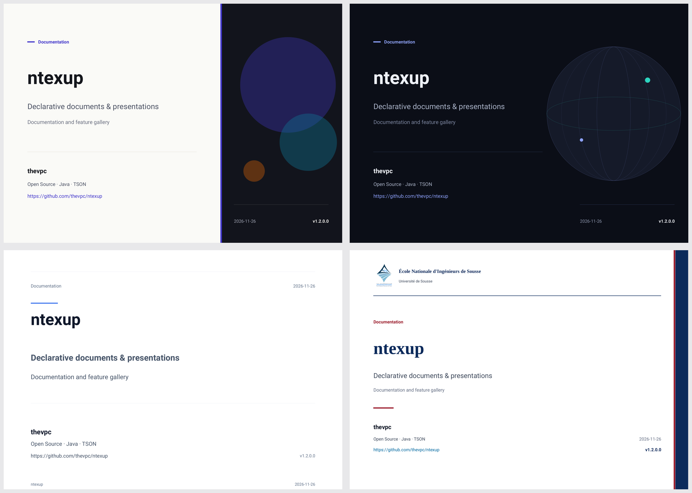
</p>

<p align="center">
  <b>Declarative documents and presentations — written as text, rendered with precision.</b><br>
  Java · <a href="https://github.com/thevpc/tson">TSON</a> · <a href="https://github.com/thevpc/nuts">Nuts</a>
</p>

<p align="center">
  <a href="LICENSE"></a>
  <a href="pom.xml"></a>
  <a href="pom.xml"></a>
  <a href="https://github.com/thevpc/nuts"></a>
</p>

**ntexup** is an open-source, text-based document and presentation generator for
professional, math-heavy, and reusable material. It combines the readability of
Markdown with the precision of LaTeX and the reuse of a template engine — and it
is designed to live in Git.

[**Documentation (PDF)**](documentation/website/ntexup-doc.pdf) ·
[**User guide**](documentation/user-guide/00-index.md) ·
[**Developer guide**](documentation/developer-guide/00-index.md) ·
[**Feature gallery**](https://github.com/thevpc/ntexup-doc-slides)

---

## Contents

- [Why ntexup](#why-ntexup)
- [Gallery](#gallery)
- [Features](#features)
- [Quick start](#quick-start)
- [A first document](#a-first-document)
- [A themed project](#a-themed-project)
- [Reusable components](#reusable-components)
- [Styling](#styling)
- [TSON at a glance](#tson-at-a-glance)
- [Rendering and output](#rendering-and-output)
- [Themes and templates](#themes-and-templates)
- [Documentation and related repositories](#documentation-and-related-repositories)
- [Building from source](#building-from-source)
- [Editor support](#editor-support)
- [Contributing](#contributing)
- [License and author](#license-and-author)

---

## Why ntexup

Traditional authoring tools force a trade-off:

| Tool | Strengths | Friction |
|------|-----------|----------|
| **PowerPoint / Keynote** | Familiar, visual | Manual layout, weak math, binary diffs |
| **LaTeX / Beamer** | Precise, excellent math | Heavy setup, slow iteration for simple slides |
| **Markdown / Asciidoctor** | Text-based, versionable | Limited layout, math, diagrams, and figures |
| **ntexup** | Text + layout + math + diagrams + themes | Still evolving |

ntexup closes that gap: you describe **what** the document contains, and the
engine handles layout, typography, and rendering. The source stays readable,
reviewable, and diff-friendly.

---

## Gallery

Every image below is a real render of the
[ntexup-doc-slides](https://github.com/thevpc/ntexup-doc-slides) deck — no mockups.

### One deck, four themes

The same pages, rendered by changing a single variable in `main.ntx`.

| `classic` | `meridian` |
|:---:|:---:|
| 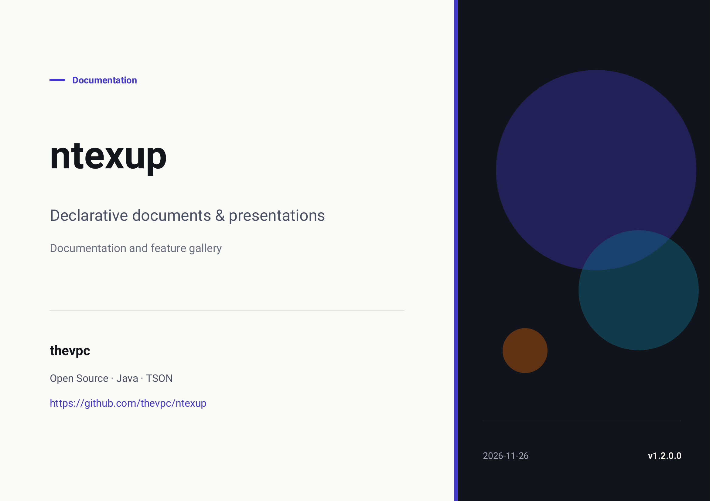 | 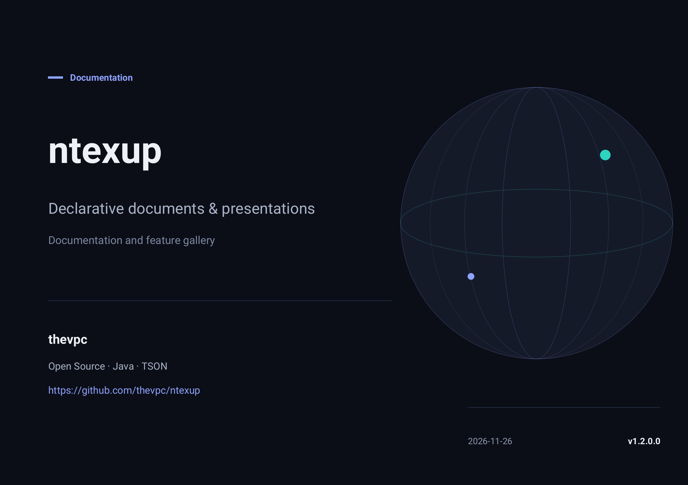 |
| *Light, editorial, warm paper and ink accents* | *Dark, modern, luminous accents and globe cover* |

| `lucid` | `eniso` |
|:---:|:---:|
| 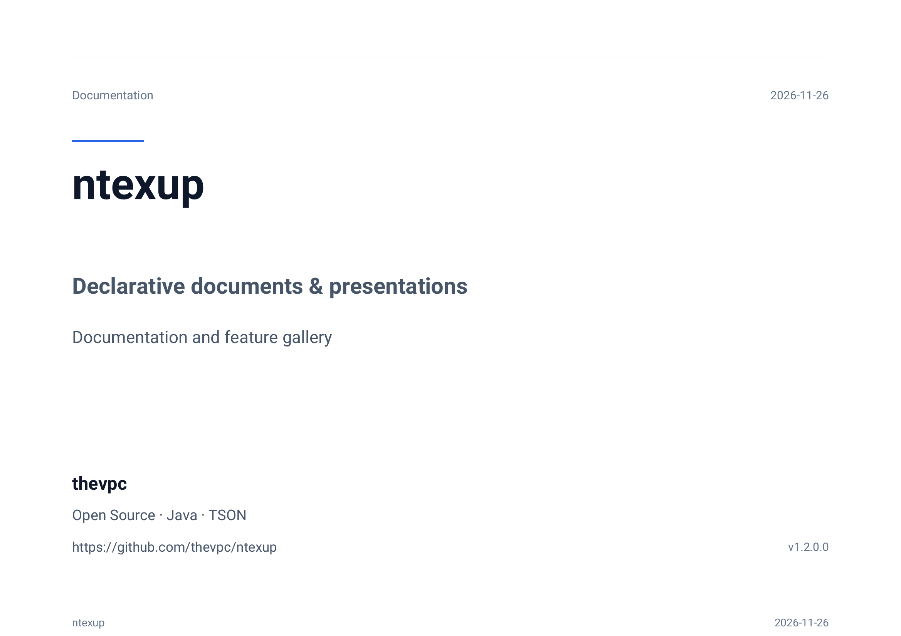 | 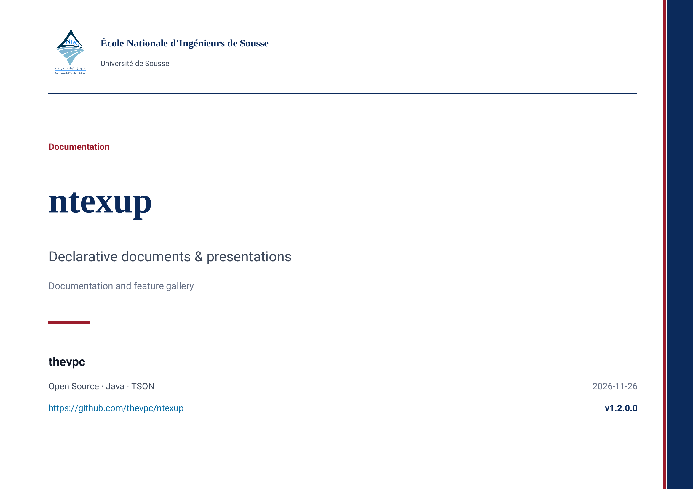 |
| *Minimalist, white page, hairlines, editorial typography* | *Academic, institutional header, serif headings* |

### The same content page, four themes

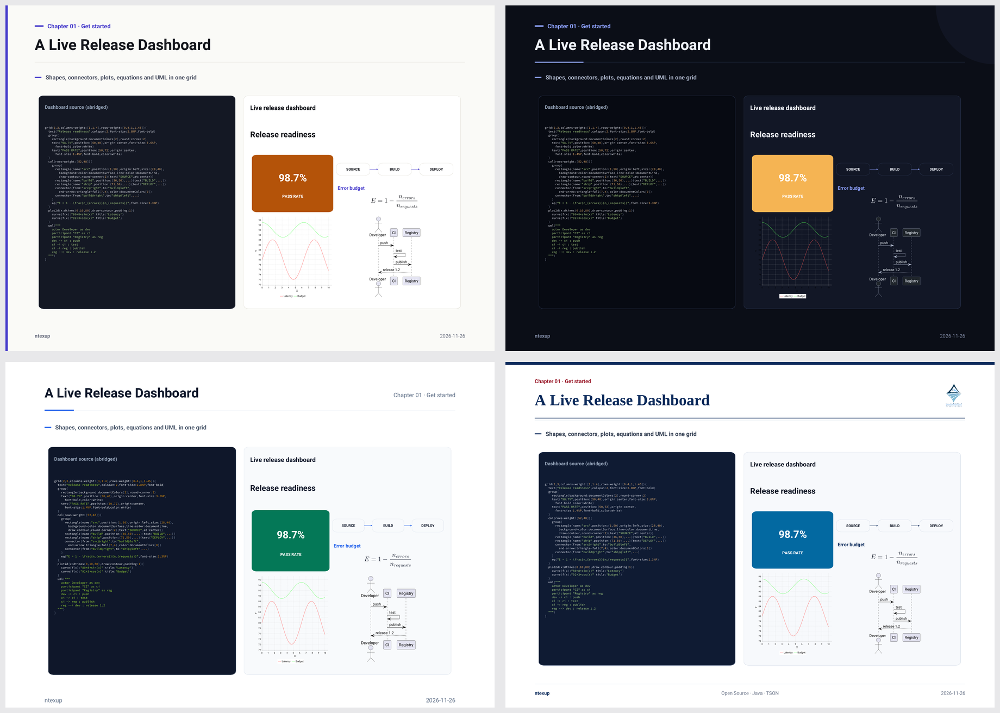

*Top-left: `classic` · top-right: `meridian` · bottom-left: `lucid` · bottom-right: `eniso`.*

### What a page can contain

| A live dashboard | Theme components |
|:---:|:---:|
| 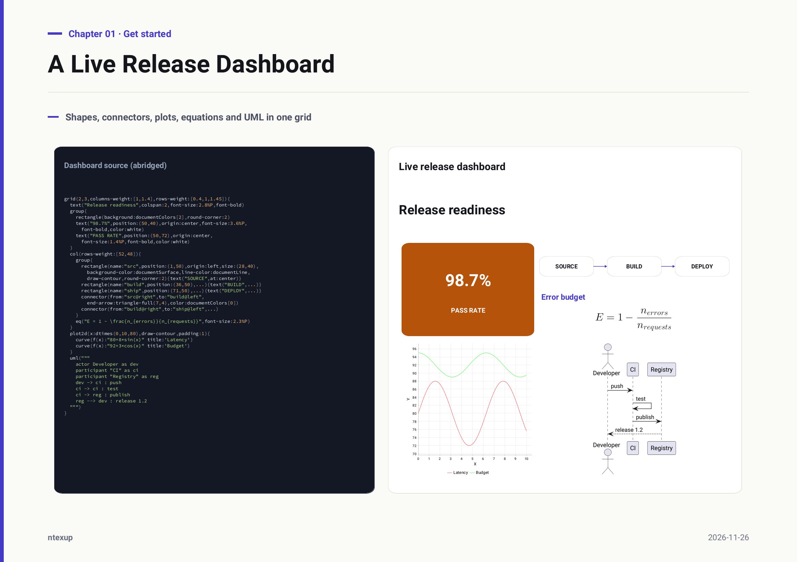 | 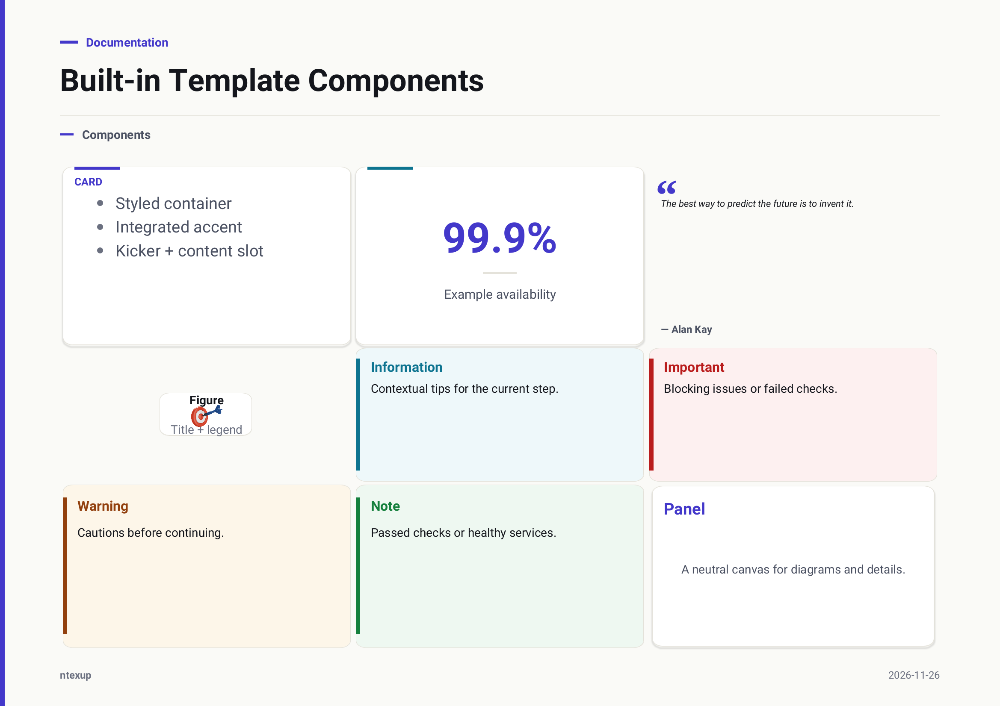 |
| Shapes, connectors, plots, equations and UML in one grid — with the TSON source beside it | Cards, stats, quotes, callouts, and academic components |

| Composed 3D scenes | UML and diagrams |
|:---:|:---:|
| 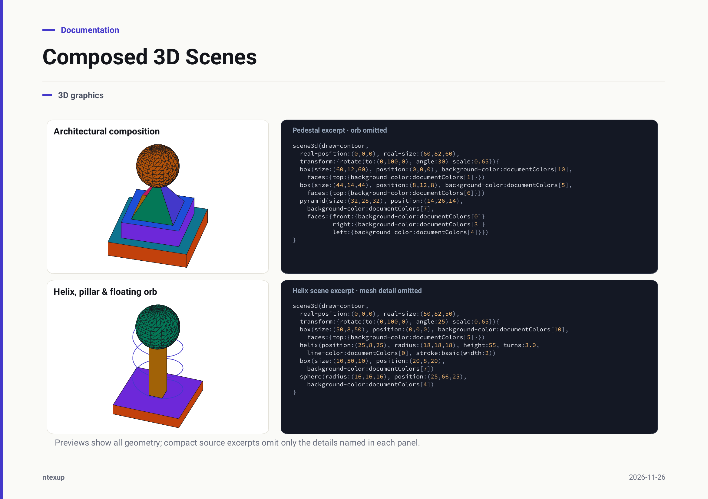 | 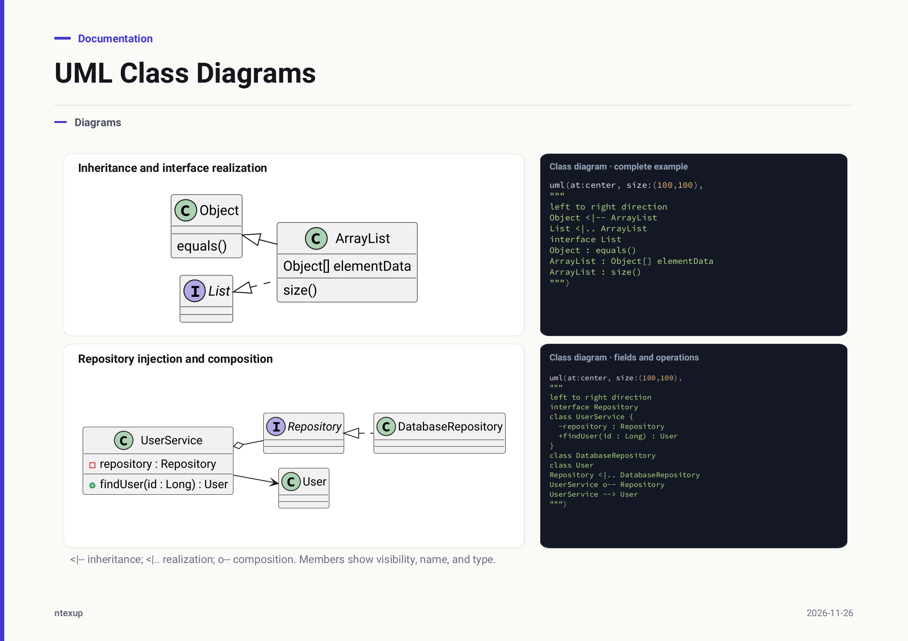 |
| Declarative 3D geometry, lighting, and composition | PlantUML class, use-case, network, Gantt, and wireframe diagrams |

| Data visualization | LaTeX mathematics |
|:---:|:---:|
| 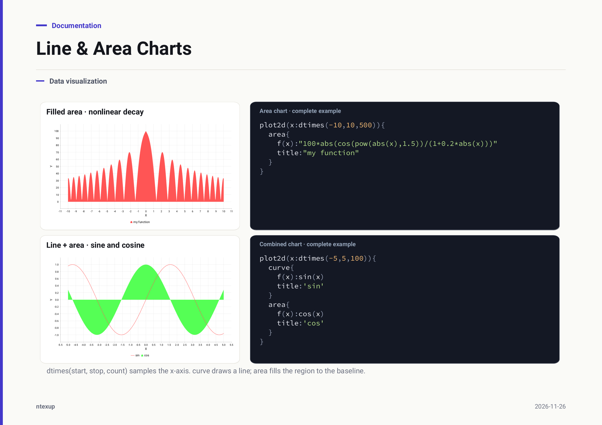 | 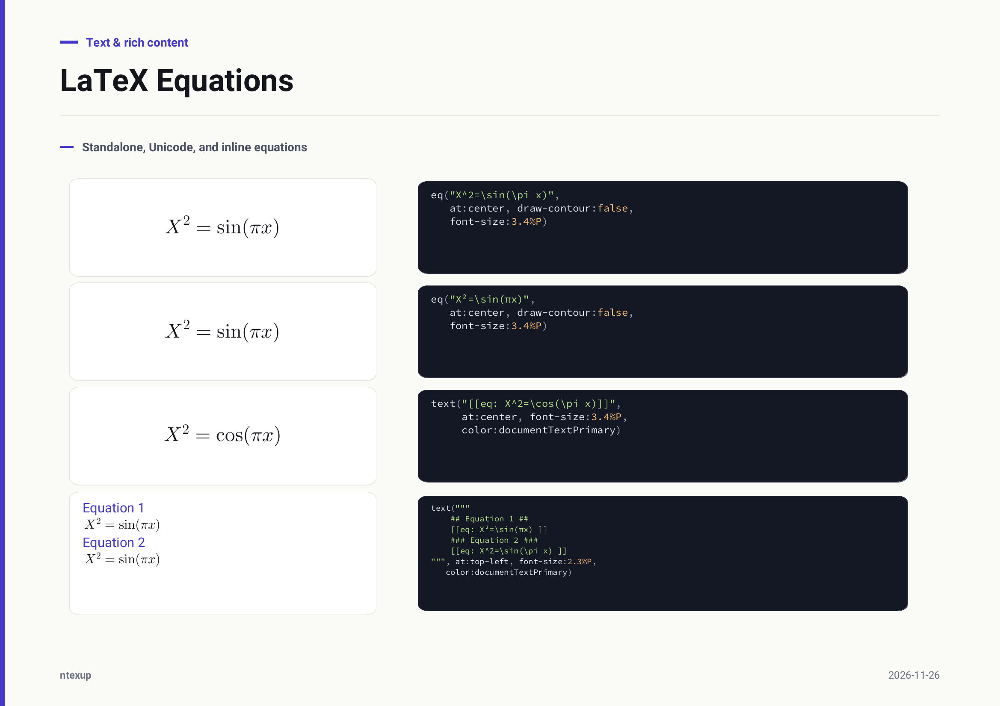 |
| Curves, areas, axes, and legends with `plot2d` | Typeset equations, inline math, and scientific notation |

---

## Features

**Authoring**
- **TSON syntax** — a readable superset of JSON with functions, variables, and expressions.
- **Declarative layout** — `page`, `grid`, `row`, `col`, `group`, and explicit `at`/`position` placement.
- **Variables, loops, and conditionals** — generate pages and content from data.
- **Reusable components** — `@define` with parameters, defaults, string interpolation, and caller slots.
- **CSS-like styling** — universal, type, and class selectors; theme variables; 12-color accent palettes.
- **Multi-file projects** — `include` local folders, globs, or GitHub repositories.

**Content**
- **LaTeX math** — the `eq` element and inline `[[eq: ...]]` expressions.
- **Diagrams** — PlantUML UML, network diagrams, Gantt charts, and wireframes.
- **Data plots** — `plot2d` curves and filled areas with sampled data.
- **2D and 3D graphics** — shapes, arrows, connectors, solids, scenes, and composition.
- **Tables and scoreboards** — styled tabular data and ranked scoreboards.
- **Source code and rich text** — syntax highlighting, NTF markup, bullets, and typography.
- **Images** — PNG, JPEG, SVG, GIF, WebP, and AVIF.

**Output**
- **Live Swing viewer** — auto-refreshes as you save.
- **Vector PDF** — selectable text and scalable geometry; raster mode is available.
- **Images** — one file per page, or captioned N-up review sheets.
- **HTML** — static pages for the web.
- **Headless rendering** — PDF, image, and HTML output work in CI and containers.
- **Extensible** — add components, functions, and renderers in Java; dependencies resolve through Nuts.

> Animated GIFs and animated connectors play in the viewer; static outputs capture a frame.

---

## Quick start

### 1. Install Nuts

```bash
curl -s https://thevpc.net/nuts/install-latest.sh | bash
# restart the terminal so `nuts` is on PATH
```

### 2. Install ntexup

```bash
nuts -y install ntexup
```

### 3. Create and open a project

```bash
nuts ntexup new my-talk -t=classic:medium
cd my-talk
nuts ntexup show .
```

The viewer refreshes automatically when you save a `.ntx` file.

### 4. Explore the built-in documentation

```bash
nuts ntexup documentation          # open the documentation deck in the viewer
nuts ntexup documentation-pdf -o ntexup-doc.pdf
```

To work on the documentation deck itself:

```bash
git clone https://github.com/thevpc/ntexup-doc-slides.git
cd ntexup-doc-slides
nuts ntexup show .
```

**Requirements:** building from source needs JDK 17+ and Maven 3.9+. Nuts
provisions a suitable JDK when none is available, so installing ntexup only
needs a working Java runtime. The Swing viewer needs a display; PDF, image, and
HTML rendering are headless.

---

## A first document

A document can be a single `.ntx` file. Because a standalone file does not load
a theme, import the element libraries it uses:

```tson
import("stdlib" "layout" "text" "shapes2d" "latex")

page {
    grid(1, 4) {
        text("Welcome to ntexup!", font-size: 5%P, font-bold)
        ¶ Plain text, rendered as-is.
        eq("x = \frac{-b \pm \sqrt{b^2-4ac}}{2a}", font-size: 3%P)
        rectangle(size: (60, 24), background: cornflowerblue, at: center)
    }
}
```

Render it:

```bash
nuts ntexup show slides.ntx          # live viewer
nuts ntexup pdf slides.ntx -o slides.pdf
```

Notes:

- `grid(1, 4)` stacks children in one column and four rows. Raw `page` children
  are absolutely positioned and overlap unless you lay them out.
- LaTeX uses **single** backslashes. Do not write `\\frac`.
- `¶` starts a raw line; quoting is not required.

---

## A themed project

Templates provide the page scaffolding (`cover-slide`, `content-slide`,
`agenda-slide`, …), theme components, and the imports needed by the deck.

**`main.ntx`**

```tson
themeName = "classic"
documentColorAccent = 0
documentTitle = "My Course"
documentSubtitle = "Lecture notes and slides"
documentAuthor = "Jane Doe"
documentDate = "2026-11-26"

include("github://thevpc/ntexup-templates/${themeName}/v1.0/theme")
include("03-lib/**/*.ntx")
include("01-styles/**/*.ntx")
include("02-pages/**/*.ntx")
```

**`02-pages/0010-slide.ntx`**

```tson
content-slide(title: "Why ntexup?", section: "Introduction") {
    body {
        grid(2, 1) {
            card(accentColor: documentColors[0]) {
                kicker("READABLE")
                ul(bullet-align: top) {
                    • "Declarative TSON is easy to read"
                    • "Author once, render consistently"
                }
            }
            card(accentColor: documentColors[1]) {
                kicker("REUSABLE")
                ul(bullet-align: top) {
                    • "Share components across decks"
                    • "CSS-like styles and themes"
                }
            }
        }
    }
}
```

Render the folder:

```bash
nuts ntexup show .
nuts ntexup pdf . -o out/course.pdf
```

The order in `main.ntx` matters: theme → libraries → styles → pages.

---

## Reusable components

Components are declared with `@define` and called like built-in nodes. They can
take parameters with defaults, interpolate values with `${...}`, and expose a
caller slot.

```tson
@define info-badge(label, accent: documentColors[0]) {
    group(margin: 1, size: (100, 22)) {
        rectangle(background: accent, round-corner: 4)
        text("${label}", color: white, font-bold, font-size: 2.2%P, at: center)
    }
}
```

```tson
info-badge("Variables, loops and conditions")
info-badge("PDF, images and HTML output", accent: documentColors[2])
```

```tson
@define feature-box(title, accent: documentColors[1]) {
    group(margin: 1) {
        rectangle(background: documentSurface, color: documentLine,
                  draw-contour: true, round-corner: 6)
        rectangle(background: accent, position: (0, 0), size: (0.35%P, 100))
        text("${title}", position: (6, 14), origin: left,
             font-bold, font-size: 2.4%P, color: accent)
        group(position: (6, 32), size: (88, 62), origin: top-left) {
            body
        }
    }
}

feature-box(title: "Custom Component Box", accent: documentColors[1]) {
    ul {
        • "Defined once with @define"
        • "Caller content enters through body"
        • "Reusable across slides and projects"
    }
}
```

Shared components usually live in `03-lib/` and are included before the pages
that use them.

---

## Styling

Styles are CSS-like and cascade from themes to `styles` blocks to inline
properties. Selectors target node types, declared classes, or everything.

```tson
styles {
    (*)        { font-size: 2%P }
    @title     { font-size: 4%P, font-bold, color: documentColors[0] }
    source     { font-size: 1.6%P, background-color: "#0f172a" }
}

@(title) text("A styled title")
```

Theme variables keep documents portable:

| Variable | Meaning |
|----------|---------|
| `documentColors[0..11]` | 12-color accent palette |
| `documentColorAccent` | active accent index (0..11) |
| `documentSurface` / `documentLine` | panel and border colors |
| `documentTextPrimary` / `documentTextSecondary` | text colors |
| `themeName` | active theme |

```tson
text("Accent 1", color: documentColors[0])
text("Accent 2", color: documentColors[1])
rectangle(size: (30, 30), background: documentColors[4], color: documentColors[2])
```

---

## TSON at a glance

TSON is the document language: a readable superset of JSON with expressions,
variables, control flow, and reusable components.

```tson
themeName = "eniso"
documentColorAccent = 2
include("github://thevpc/ntexup-templates/${themeName}/v1.0/theme")

sectionName = "Chapter"

for (i: [1 -> 3]) {
    text("${sectionName} ${i}", font-size: 3%P, font-bold)
}

if (documentColorAccent > 0) {
    ¶ A non-default accent is active.
}
```

**Assignments**

```tson
x = 42              // unconditional
y := 42             // assign only if undefined (theme defaults)
```

**Ranges and loops**

```tson
for (i: [1 -> 5])             { text("Item ${i}") }
for (x: [0 -> 100 step 10])   { text(x) }
```

**Includes and imports**

```tson
include("03-lib/**/*.ntx")
include("02-pages/**/*.ntx")
include("github://thevpc/ntexup-templates/${themeName}/v1.0/theme")

import("shapes2d" "plantuml" "plot2d")
```

**Text and math**

```tson
text("Bold, *italic*, and [[eq: E = mc^2]] inline.")
eq("E = 1 - \frac{n_{errors}}{n_{requests}}", font-size: 3%P)
source(java, """
    public record Point(int x, int y) {}
    """)
```

See the [TSON Syntax guide](documentation/user-guide/04-tson-syntax.md) and the
[Control Flow guide](documentation/user-guide/20-control-flow.md) for the full
language.

---

## Rendering and output

| Output | Command |
|--------|---------|
| Live viewer | `nuts ntexup show .` |
| Vector PDF | `nuts ntexup pdf . -o out/talk.pdf` |
| Raster PDF | `nuts ntexup pdf . -o out/talk.pdf --pdf-mode=raster --dpi=150` |
| PNG per page | `nuts ntexup image . -o out/images` |
| Page range | `nuts ntexup image . -o out/page.png --pages=2-5` |
| N-up review sheets | `nuts ntexup image . --grid=4x2 --page-labels -o out/review` |
| Static HTML | `nuts ntexup html .` |
| Validate everything | `nuts ntexup check . --strict` |

`check` renders every page in memory — including lazy-compiled pages — and fails
on errors, which makes it suitable for CI.

---

## Themes and templates

Templates are published in
[ntexup-templates](https://github.com/thevpc/ntexup-templates) and loaded with a
single include:

```tson
themeName = "meridian"
documentColorAccent = 3

include("github://thevpc/ntexup-templates/${themeName}/v1.0/theme")
```

| Theme | Character |
|-------|-----------|
| `classic` | Light, editorial, warm paper and ink accents (recommended default) |
| `meridian` | Dark, modern, luminous accents and globe cover |
| `lucid` | Minimalist, white page, hairlines, editorial typography |
| `eniso` | Academic, institutional header, serif headings, navy and crimson |
| `ibtihel` | Alternative template style |

`classic`, `meridian`, `lucid`, and `eniso` share the modern component API
(`content-slide`, `card`, `kicker`, `stat`, `quote`, `panel`, `hint-*`,
`definition`, `theorem`, `example`, `remark`, `image-fig`), so switching themes
needs no page edits.

Create a new project from any theme and layout:

```bash
nuts ntexup new course  -t=classic:medium
nuts ntexup new handout -t=meridian:small
nuts ntexup new thesis  -t=eniso:large
```

Layouts: `small` (single file), `medium` (sections as files), `large` (sections
as subfolders).

---

## Documentation and related repositories

- **Documentation PDF** — [ntexup-doc.pdf](documentation/website/ntexup-doc.pdf) (49 pages, rendered from the documentation deck).
- **User guide** — [documentation/user-guide](documentation/user-guide/00-index.md): installation, syntax, layout, styling, themes, CLI, and reference tables.
- **Developer guide** — [documentation/developer-guide](documentation/developer-guide/00-index.md): architecture, rendering pipeline, and extension development.
- **[ntexup-doc-slides](https://github.com/thevpc/ntexup-doc-slides)** — the living feature gallery used for every screenshot in this README.
- **[ntexup-templates](https://github.com/thevpc/ntexup-templates)** — the `classic`, `meridian`, `lucid`, `eniso`, and `ibtihel` themes.
- **[TSON](https://github.com/thevpc/tson)** — the document syntax specification.
- **[Nuts](https://github.com/thevpc/nuts)** — the package manager and runtime used by ntexup.

---

## Building from source

```bash
git clone https://github.com/thevpc/ntexup.git
cd ntexup
mvn verify
```

The build uses the Maven settings committed in `.mvn/`; no workstation-specific
mirror is required. Reactor modules stay on the same version (`1.2.0.0`).

To use a locally built artifact through Nuts:

```bash
mvn install
nuts -y install --reinstall net.thevpc.ntexup:ntexup#1.2.0.0
```

---

## Editor support

Install syntax highlighting for `.ntx` files:

```bash
nuts ntexup install-editor-syntax=vim
nuts ntexup install-editor-syntax=vscode
nuts ntexup install-editor-syntax=kate
nuts ntexup install-editor-syntax=intellij
```

Supported editors: `vim`, `vscode`, `gedit`, `kate`, `intellij`, `jedit`, and
`notepad-plus-plus`. Use `install-editor-syntax=all` to install every family.

---

## Contributing

Contributions are welcome:

- Report issues and propose features.
- Improve the documentation and example decks.
- Add components, renderers, or editor integrations.
- Share templates and themes built with ntexup.

Please keep changes focused and run `mvn verify` (and `nuts ntexup check` for
deck changes) before opening a pull request.

---

## License and author

- **License:** [LGPLv3](LICENSE)
- **Source:** [github.com/thevpc/ntexup](https://github.com/thevpc/ntexup)
- **Status:** usable, actively used for teaching, and still evolving
- **Maintainer:** [thevpc](https://github.com/thevpc)
